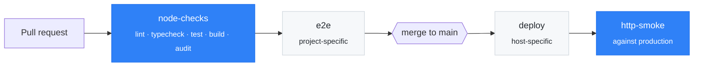

<div align="center">

# workflows

**Reusable GitHub Actions for shipping web projects without breaking production.**

[](https://github.com/LeonAchata/workflows/actions/workflows/self-test.yml)
[](https://github.com/LeonAchata/workflows/releases)
[](LICENSE)

</div>

I build and maintain several websites: Next.js, Vite + React, a few with a Python
backend. They're deployed to very different places (Hostinger, shared cPanel hosting over FTPS, a VPS).
They all needed the same CI job, copy-pasted it, and drifted apart:
one repo on `actions/checkout@v4`, another on `@v5`, one with a type check, one without.

This repository is the fix: the parts every web project shares live here once,
are tested here, and are versioned like a library. Each project keeps only what is
truly its own: its end-to-end tests and its deploy.

## What's inside

| Workflow | What it does |
| --- | --- |
| [`node-checks.yml`](.github/workflows/node-checks.yml) | Installs dependencies with the right package manager, runs your `package.json` scripts in order, audits production dependencies and can hand the build output to a deploy job. |
| [`http-smoke.yml`](.github/workflows/http-smoke.yml) | After a deploy, waits until the **new** version is actually live, then checks status codes, page content and redirects on the real site. Works with any host. |

## Where they fit



Blue boxes come from this repo. Grey ones stay in each project, because no two
projects test or deploy the same way, and a generic workflow with fifteen inputs to cover them all
would be harder to read than the twenty lines it replaces.

## Quick start

```yaml
# .github/workflows/ci.yml in your project
name: CI
on:
  pull_request:
  push:
    branches: [main]

jobs:
  checks:
    uses: LeonAchata/workflows/.github/workflows/node-checks.yml@v1
```

That's the whole file. With no inputs it detects npm or pnpm from the lockfile,
reads the Node.js version from `.nvmrc` (or uses 22), runs `lint` and `build`
and fails on high-severity vulnerabilities in production dependencies.

---

## `node-checks.yml`

| Input | Default | Description |
| --- | --- | --- |
| `working-directory` | `.` | Folder with `package.json`. Set it in monorepos, e.g. `frontend`. |
| `scripts` | `lint build` | `package.json` scripts to run, in order. Stops at the first failure. |
| `node-version` | `22` | Used only when the project has no `.nvmrc` or `.node-version`. |
| `audit-level` | `high` | Minimum severity that fails `npm audit` / `pnpm audit` on production dependencies. Empty to skip. |
| `env` | | Extra non-secret variables, one `KEY=VALUE` per line. Useful for values inlined at build time, such as `NEXT_PUBLIC_*`. |
| `artifact-path` | | Build output to upload, e.g. `dist`. Empty to skip. |
| `artifact-name` | `build` | Name of that artifact. |

| Output | Description |
| --- | --- |
| `package-manager` | `npm` or `pnpm`. |

**Behaviour worth knowing**

- **Package manager from the lockfile.** `pnpm-lock.yaml` → pnpm (version from the `packageManager` field), `package-lock.json` → npm. No lockfile is an error: installs must be reproducible.
- **Scripts are yours.** The workflow doesn't guess how to lint or type-check. It runs what `package.json` declares, so the CI does exactly what `npm run <script>` does locally.
- **One summary per run.** Every script's result and duration goes to the job summary.
- **Production-only audit.** A vulnerable dev tool doesn't ship to visitors. A vulnerable runtime dependency does.

## `http-smoke.yml`

| Input | Default | Description |
| --- | --- | --- |
| `base-url` | **required** | The live site, e.g. `https://example.com`. |
| `checks` | **required** | One check per line: `STATUS PATH [TEXT]`. See below. |
| `wait-for-path` | | Poll this path before checking… |
| `wait-for-text` | | …until its body contains this text, usually `${{ github.sha }}`. |
| `wait-timeout` | `900` | Seconds to keep polling. |
| `delay` | `0` | Fixed wait, for hosts where the new version can't be detected. |

```text
# STATUS PATH [TEXT]
# The body must contain "Leon Achata" (TEXT is everything after the path)
200 /en Leon Achata
404 /en/missing-page
# For 3xx, TEXT is matched against the Location header
307 / /en
```

**Why the wait matters.** Hosts that build from Git (Hostinger, Netlify, Vercel…)
deploy *after* your push, on their own schedule. Smoke-testing right away tests
the **previous** version and passes for the wrong reason. Exposing the commit SHA
(e.g. a `/api/version` route) and waiting for it means the checks only run once
the new build is serving traffic.

Redirects are never followed, so a check can tell a `307` from the `200` it points to.
Each status check is retried up to 3 times to absorb a cold start or a CDN hiccup.

---

## Recipes

<details>
<summary><b>Next.js on a host that builds from Git</b> (Hostinger, Netlify…)</summary>

```yaml
# ci.yml
jobs:
  checks:
    uses: LeonAchata/workflows/.github/workflows/node-checks.yml@v1
    with:
      scripts: lint typecheck build   # "typecheck": "next typegen && tsc --noEmit"

  e2e:
    needs: checks
    runs-on: ubuntu-latest
    steps:
      - uses: actions/checkout@v7
      - uses: actions/setup-node@v7
        with: { node-version-file: .nvmrc, cache: npm }
      - run: npm ci
      - run: npx playwright install --with-deps chromium
      - run: npx playwright test
```

```yaml
# post-deploy.yml
on:
  push:
    branches: [main]
jobs:
  smoke:
    uses: LeonAchata/workflows/.github/workflows/http-smoke.yml@v1
    with:
      base-url: https://example.com
      wait-for-path: /api/version
      wait-for-text: ${{ github.sha }}
      checks: |
        200 /en
        200 /sitemap.xml
        307 / /en
```

</details>

<details>
<summary><b>Vite app in a monorepo, deployed over FTPS</b> (shared cPanel hosting)</summary>

```yaml
jobs:
  checks:
    uses: LeonAchata/workflows/.github/workflows/node-checks.yml@v1
    with:
      working-directory: frontend
      artifact-path: dist

  deploy:
    needs: checks
    if: github.ref == 'refs/heads/main'
    runs-on: ubuntu-latest
    concurrency: deploy
    steps:
      - uses: actions/download-artifact@v8
        with: { name: build, path: dist }
      - uses: SamKirkland/FTP-Deploy-Action@v4.4.0
        with:
          server: ${{ secrets.FTP_SERVER }}
          username: ${{ secrets.FTP_USERNAME }}
          password: ${{ secrets.FTP_PASSWORD }}
          protocol: ftps
          local-dir: dist/

  smoke:
    needs: deploy
    uses: LeonAchata/workflows/.github/workflows/http-smoke.yml@v1
    with:
      base-url: https://example.com
      checks: |
        200 /
        200 /contact
```

The build that's deployed is the exact one that passed the checks: it's built once and passed along as an artifact.

</details>

<details>
<summary><b>Frontend plus its own backend job</b></summary>

```yaml
jobs:
  frontend:
    uses: LeonAchata/workflows/.github/workflows/node-checks.yml@v1
    with:
      working-directory: frontend

  backend:   # stays project-specific: Docker, Postgres, curl against the API…
    runs-on: ubuntu-latest
    steps:
      - uses: actions/checkout@v7
      - run: docker build -t api backend
```

</details>

---

## Design decisions

- **Reusable workflows, not composite actions.** A reusable workflow is a whole job: its own runner, timeout, permissions and summary, and it shows up as one clean check on the pull request. A composite action is a list of steps pasted into someone else's job. For "the standard checks", a job is the right unit.
- **Share the boring part, keep the specific part local.** Install/lint/build is the same everywhere. End-to-end tests and deploys are not, so they aren't abstracted.
- **Least privilege.** `node-checks` asks for `contents: read`, `http-smoke` for no token permissions at all. Caller inputs reach shell scripts through environment variables, never through `${{ }}` interpolated into the script.
- **Convention over configuration.** Lockfile → package manager, `.nvmrc` → Node.js version, `package.json` → what to run. The project already says all of this. Repeating it in YAML is how drift starts.
- **Tested like code.** Every change runs [`self-test.yml`](.github/workflows/self-test.yml): [actionlint](https://github.com/rhysd/actionlint) with shellcheck over every workflow, both workflows called exactly the way a consumer would against an npm and a pnpm [fixture](fixtures/), and a job that asserts on their outputs and artifacts.

## Versioning

Releases follow [semver](https://semver.org). Pin the major tag:

```yaml
uses: LeonAchata/workflows/.github/workflows/node-checks.yml@v1
```

Pushing `v1.2.0` runs [`release.yml`](.github/workflows/release.yml), which publishes the release notes and moves `v1` to it.
Fixes and new optional inputs land in `v1`. Anything that would break an existing caller becomes `v2`.
For full reproducibility you can pin an exact tag (`@v1.2.0`) or a commit SHA instead.

Dependabot keeps the actions used here up to date, so every project pinned to `@v1` gets those updates without touching its own files.

## License

[MIT](LICENSE) © Leon Achata
